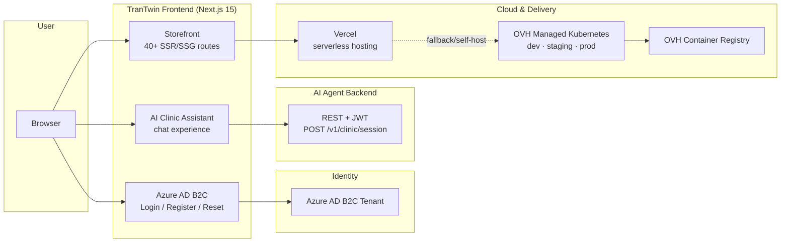
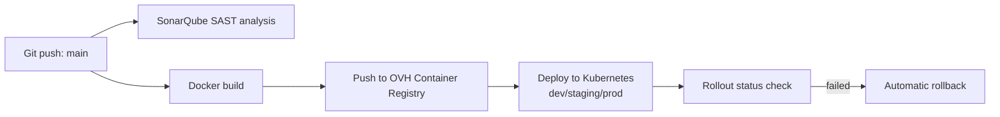

<div align="center">

# TranTwin

**A cloud-native eCommerce platform with an embedded AI assistant — engineered end-to-end**
from **storefront** to **Kubernetes** to **CI/CD**.

`Next.js` · `TypeScript` · `styled-components` · `Azure DevOps` · `OVH Managed Kubernetes` · `Vercel` · `SonarQube` · `Docker`

**🔗 Live demo:** <https://tran-twin-tan.vercel.app/>

---

</div>

---

## Overview

TranTwin is a production-oriented eCommerce showcase that demonstrates the **full software delivery lifecycle**, not just a pretty UI:

- A **40+ route, multi-vendor storefront** built on Next.js 15 (App Router) with server-rendered catalog, search, cart, checkout, payments, wishlist, and a vendor dashboard.
- An embedded **AI assistant experience** ("DBP Clinic") — an agent-driven chat that talks to a deployed backend over a **JWT-secured REST API** and persists conversation sessions.
- **Enterprise-grade Azure AD B2C authentication** wired into the storefront (login / register / password reset) with session handling on the client.
- A complete **Cloud + CI/CD story**: Docker image builds, container registry, Kubernetes manifests with health probes, multi-environment deployments (dev → staging → prod), automatic rollback, and SAST code scanning.
- A **simulated API layer** (`src/__server__`) so the entire commerce experience runs offline — every route responds with realistic mock data.

> This repository is a portfolio of **platform engineering** — the interesting parts are the pipelines, the deployment topology, and the security posture, not just the pixels.

---

## Highlights

| Area | What's here |
| --- | --- |
| **Cloud deployment** | Vercel for serverless front-end hosting; OVH Container Registry + OVH Managed Kubernetes for containerized self-hosted deployment |
| **CI/CD pipelines** | Azure Pipelines: build → push image → deploy to Kubernetes, with **automatic rollback** if a rollout fails |
| **Security / SAST** | SonarQube analysis pipeline on every run; dependency & vulnerability hardening |
| **Containerization** | Multi-environment Dockerfile + k8s manifests with liveness/readiness probes |
| **Authentication** | Azure AD B2C (OIDC authorization code + PKCE-style flow), JWT decode + client-side session store |
| **AI / Agents** | AI assistant UI that provisions backend chat sessions and streams a multi-session conversation flow |
| **Testing & quality** | **Vitest** unit tests + **Playwright** E2E smoke tests, TypeScript type checking (`tsc --noEmit`) and lint/type gates in the build pipeline |
| **Secrets management** | All credentials externalised to environment variables (`.env` / Vercel env) — server-only secrets stay out of the client bundle |
| **Reliability** | Static-site prerendering (42 static routes), dynamic server-rendered product/vendor pages |

---

## Architecture



**CI/CD flow**



---

## Tech Stack

**Frontend & runtime**
- Next.js 15 (App Router) · React 18 · TypeScript 5.6
- styled-components + styled-system (theming), Emotion
- formik + yup (forms/validation), react-select, react-paginate, react-dropzone
- chart.js / react-chartjs-2 (vendor analytics), react-markdown, react-slick carousels
- lucide-react / react-icons

**Auth & IDs**
- Azure AD B2C (OIDC authorization-code flow, user flows: Login / Register / PasswordReset)
- `jwt-decode` + client session store

**Infrastructure & delivery**
- Docker · OVH Container Registry · OVH Managed Kubernetes
- Azure Pipelines (YAML) — build/push/deploy + deploy-rollback pipeline
- SonarQube (SAST) via Azure Pipelines
- Vercel (serverless hosting & preview deployments)

---

## Cloud & DevOps deep-dive

### CI/CD — Azure Pipelines
The delivery pipeline is defined in **declarative YAML** and uses Azure DevOps **variable groups + secure files** for registry credentials and the kubeconfig (no secrets in the repository).

1. **`azure-pipelines.yml`**
   - Logs into the OVH container registry using library-stored credentials.
   - Builds the production Docker image and pushes it with a unique `$(Build.BuildId)` tag.
   - Renders the correct `deployment.yaml` for the target environment.
   - Applies it to OVH Managed Kubernetes in the `dev` / `staging` / `prod` namespace.
2. **`azure-pipeline-rollback.yml`**
   - Same build & deploy flow, plus `kubectl rollout status` gate.
   - If the rollout does not become healthy within the timeout, the pipeline marks the deployment as failed and a **Rollback stage automatically runs `kubectl rollout undo`**.

### SAST — SonarQube
`Azure-SAST- pipeline.yml` runs **SonarQube static analysis** (`SonarQubePrepare/Analyze/Publish`) with a project key defined per environment, giving clean quality-gate feedback on every build.

### Containerization & Kubernetes
- `Dockerfile` — pinned Node 18 Alpine base, production build in-container (`npm run build`), started with `next start`.
- `k8s/{dev,staging,production}/deployment.yaml` — Deployment + Service per environment with:
  - 2 replicas, `app: dt-front` selectors
  - **readiness and liveness probes** against `/` on port 3000
  - `imagePullSecrets` for the private registry
  - LoadBalancer Services mapped to the container port

### Serverless hosting — Vercel
The app is deployed on Vercel: **<https://tran-twin-tan.vercel.app/>** (project `tran-twin`), with instant preview environments per PR.

### Secrets management
All credentials are externalised to environment variables — nothing sensitive lives in the codebase:

- Public config (B2C tenant, client id, redirect URI, flow names, clinic API URL) uses `NEXT_PUBLIC_*`.
- **Server-only secrets** (`AZURE_B2C_CLIENT_SECRET`, `CLINIC_API_BEARER_TOKEN`) are read exclusively inside `src/app/api/**` Route Handlers and are **never** prefixed with `NEXT_PUBLIC_`, so they never reach the browser bundle.
- The B2C token exchange and the Clinic AI calls are proxied through `/api/auth/token` and `/api/clinic/session` respectively, keeping the bearer token and client secret on the server.
- `.env` is gitignored; `.env.example` documents the required keys.

### Hardening in practice
The repository also contains a real-world security fix: the upstream pinned version (Next.js `15.0.1`) was **rejected by Vercel's "vulnerable version" gate**, so the dependency was upgraded to the fully-patched **Next.js `15.5.27`**, unblocking deployment and closing the underlying CVE surface.

---

## Getting Started

**Prerequisites:** Node.js ≥ 18.18 · npm 10+

```bash
# 1. Install dependencies
npm install

# 2. Configure environment (copy the example and fill in values)
cp .env.example .env    # Windows: copy .env.example .env

# 3. Start the dev server
npm run dev

# 4. Production build + start
npm run build
npm start
```

The storefront runs fully offline via the built-in mock API layer — no external backend required. The auth and AI-assistant features degrade gracefully if their credentials are not supplied.

### Environment variables

| Variable | Scope | Purpose |
| --- | --- | --- |
| `NEXT_PUBLIC_AZURE_B2C_TENANT_NAME` | public | Azure AD B2C tenant name |
| `NEXT_PUBLIC_AZURE_B2C_CLIENT_ID` | public | B2C application (client) id |
| `NEXT_PUBLIC_AZURE_B2C_REDIRECT_URI` | public | OAuth redirect URI |
| `NEXT_PUBLIC_AZURE_B2C_SCOPE` | public | Requested scopes |
| `NEXT_PUBLIC_AZURE_B2C_FLOW_LOGIN/REGISTER/PASSWORD_RESET` | public | B2C user-flow names |
| `AZURE_B2C_CLIENT_SECRET` | **server-only** | Client secret for the server-side token exchange |
| `NEXT_PUBLIC_CLINIC_API_URL` | public | Clinic AI backend base URL |
| `CLINIC_API_BEARER_TOKEN` | **server-only** | Service token attached by the API proxy |

### Project structure

```
src/
├─ app/               # Next.js App Router pages & routes (40+)
│  ├─ api/                  # Server-only Route Handlers (auth token, clinic proxy)
│  ├─ (layout-1)/clinic/    # AI assistant chat ("Clinic")
│  └─ auth/                 # Azure AD B2C auth + session
├─ components/        # Reusable styled UI primitives
├─ page-sections/     # Homepage/shop section compositions
├─ lib/config.ts      # Environment-driven configuration
├─ __server__/        # Simulated REST API + mock data (all shops)
├─ contexts/          # Shopping-cart / global state
├─ interfaces/        # Domain models (Product, Order, Address…)
└─ theme/             # styled-system design tokens
e2e/                  # Playwright end-to-end smoke tests
k8s/                  # dev · staging · production manifests
azure-pipelines.yml   # CI/CD: build → push → deploy
azure-pipeline-rollback.yml # deploy + auto-rollback
Azure-SAST- pipeline.yml   # SonarQube static analysis
Dockerfile            # Container build for OVH k8s / registry
```

---

## Testing

| Layer | Tooling | Command |
| --- | --- | --- |
| Unit / component | **Vitest** (+ jsdom) | `npm test` |
| End-to-end smoke | **Playwright** (Chromium) | `npm run test:e2e` |
| Type safety | TypeScript | `npx tsc --noEmit` |

Tests live alongside their subjects (`*.test.ts`) and in `e2e/`. The unit suite covers the config/URL builders, B2C session handling, and the mock API layer; the E2E suite smoke-tests the critical storefront routes.

> First E2E run requires browser binaries: `npx playwright install chromium`.

---

## Scripts

```bash
npm run dev        # Next.js dev server
npm run build      # Production build (compiles, type-checks, lint-gates)
npm start          # Run the production server
npm run lint       # ESLint (Next.js)
npm test           # Vitest unit tests
npm run test:e2e   # Playwright end-to-end smoke tests
```

---

## Roadmap

- Add coverage gates and a **Playwright CI job** alongside the existing pipelines.
- Convert mock API layer to a tested, containerized **Node API service**.
- Add **Infrastructure-as-Code** (Terraform/OpenTofu) for the OVH Kubernetes cluster and registry.
- Add GitHub Actions workflow mirroring the Azure pipeline for portability.

---

## License

Themes under the ThemeForest Standard License (see `package.json`).